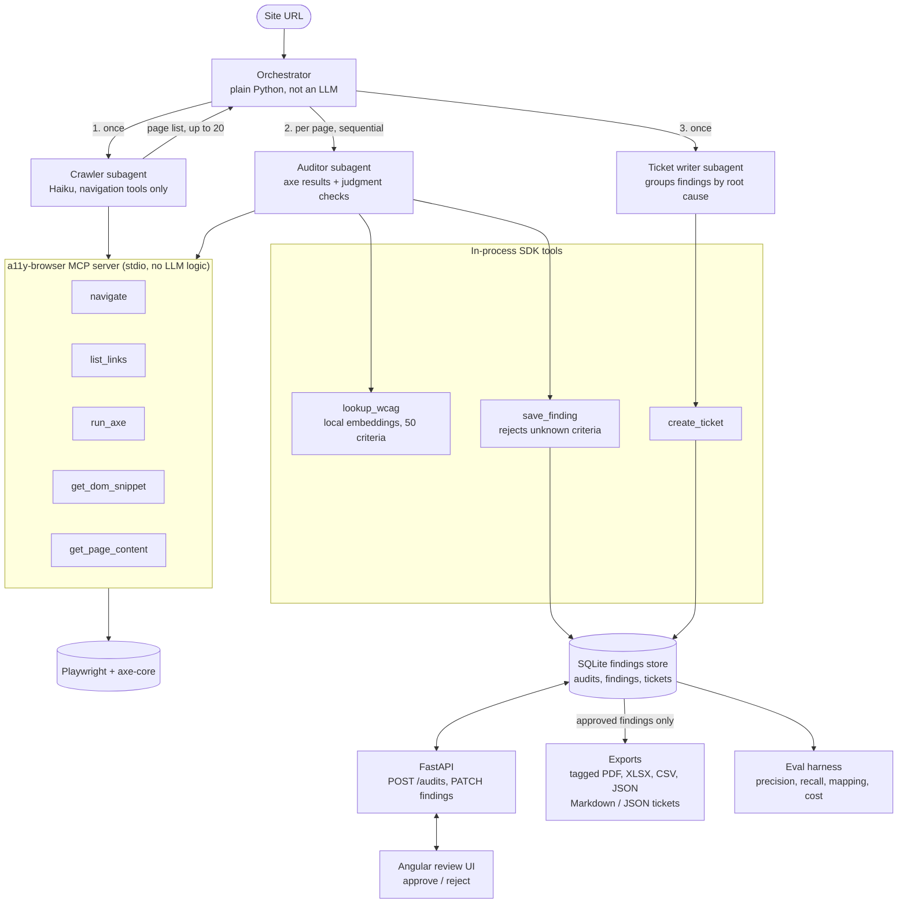

# Accessibility Audit Agent

[](https://github.com/DianaPilat/a11y-audit-agent/actions/workflows/ci.yml)
[](LICENSE)

An AI agent that audits a website against **WCAG 2.1 AA** and **Section 508**, explains each issue in plain language, and drafts fix-ready remediation tickets. A human reviews every finding before it reaches a client-facing report.

Deterministic rules (axe-core) run first. The LLM handles only what rules can't judge: whether alt text is meaningful, whether link text makes sense out of context, whether headings form a sensible outline, whether a form label is clear.

> This is an assessment aid, not a compliance certification or a replacement for a manual audit. See [Limitations](#limitations).

<!-- Add screenshots here: docs/review-ui.png (review screen) and docs/sample-report.png (PDF page). -->

## Results

Measured on a labeled eval set (15 seeded pages, 3 of them clean, plus 5 pages from the W3C Before-After Demonstration), using the cheapest Claude model (Haiku 4.5). Labels are ground truth and are never edited to improve a score. Full history is in [evals/results.md](evals/results.md).

| | Seeded pages | W3C BAD pages |
| --- | --- | --- |
| Precision | 100% (26/26) | 100% (27/27) |
| Recall | 100% (31/31) | 48% (24/50 in-scope labels) |
| WCAG criterion mapping | 100% | n/a |
| False positives on clean pages | 0 of 3 pages | n/a |
| Cost | about $0.05 per page, about 36 s per page | |

How to read these numbers:

- The seeded score is partly tuned: one prompt change was written after reading the page 07 results. The BAD pages are the held-out check, and recall there is the main open gap (1.3.1, 1.4.1, 2.4.1, 2.4.6 are missed on every page).
- BAD precision is lenient, because findings are matched by WCAG criterion only.
- Each figure comes from a single run, so differences of a few points are within noise.

## How it works



1. **Crawl.** A crawler subagent finds up to 20 same-site pages.
2. **Audit.** One auditor run per page runs axe-core, adds the judgment checks, maps each issue to a WCAG success criterion with `lookup_wcag`, and stores it with `save_finding`.
3. **Ticket.** A ticket writer groups findings by root cause (one missing `<main>` landmark should be one ticket, not forty) and drafts a ticket with a suggested code fix for each group.
4. **Review.** In the web UI a person approves or rejects each finding. Only approved findings are exported.

### Design decisions

- **Plain-Python orchestration, not an LLM orchestrator.** The first version used an LLM to delegate, and it sometimes stopped after one page. A simple loop guarantees every crawled page is audited, costs no tokens, and is easy to test.
- **Subagents per page, not one long-running agent.** I compared both on the eval set ([evals/results.md](evals/results.md)). A single agent was about 27% cheaper and twice as fast with the same recall, but it saved fewer judgment findings (6 vs 11 on the seeded set) and its context grows with every page. Per-page subagents keep failures isolated and context bounded, and give the UI per-page progress.
- **Browser access only through our own MCP server.** It wraps Playwright and axe-core, has retries and timeouts, contains no LLM logic, and returns compact accessibility-focused results to keep token costs down. Because it is a standalone stdio server, Claude Code or any other MCP client can use it too.
- **Scoped tools per subagent.** Each run gets only the tools it needs, and the SDK's built-in tools (Bash, file writes) are disabled.
- **Validation at the boundary.** `save_finding` rejects any criterion that isn't one of the 50 WCAG 2.1 A/AA criteria, so the model can't invent one.
- **Local WCAG retrieval.** `lookup_wcag` embeds the criteria with sentence-transformers (`all-MiniLM-L6-v2`) on the local machine, so mapping issues to criteria costs no API tokens.
- **Human in the loop.** Reports and ticket exports include approved findings only. Report wording says "assessment", never "compliant", and every report carries a limitations statement.
- **Cost visibility.** `UsageTracker` logs every tool call with tokens and cost per subagent.

## Features

- Crawl and audit up to about 20 pages with a headless browser.
- Judgment checks for alt text quality, link text meaning, heading structure and form label clarity.
- Each finding carries its WCAG criterion, severity, source (axe-core or AI-assessed), confidence and plain-language explanation.
- Remediation tickets with a suggested code fix, exported as Markdown or JSON.
- Angular review UI: start an audit, watch progress, approve or reject findings.
- Client-ready report from approved findings: a tagged PDF (PDF/UA-1, validated with veraPDF), plus XLSX, CSV and JSON.
- Eval harness with labeled pages that scores precision, recall, WCAG mapping, cost and latency.

## Tech stack

| Layer | Choice |
| --- | --- |
| Backend | Python, FastAPI |
| Agent | Claude Agent SDK (Python): plain-Python orchestrator and three subagents |
| Browser | Playwright and axe-core, behind our own MCP server (MCP Python SDK) |
| Retrieval | sentence-transformers over the WCAG success criteria |
| Storage | SQLite |
| Frontend | Angular, TypeScript |
| Reports | WeasyPrint (tagged PDF), veraPDF validation, openpyxl (XLSX), CSV, JSON |
| Tests | pytest, Angular component tests |

## Project layout

```
backend/app/     agent.py (orchestration), mcp_server.py + browser.py, wcag.py,
                 findings.py, tickets.py, observability.py, evals.py, report/
backend/tests/   pytest suite (live Claude tests are opt-in)
frontend/        Angular review UI and export panel
evals/           15 seeded pages, W3C BAD labels, run history, results.md
PLAN.md          scope, architecture and milestones
```

## Getting started

Requirements: Python 3.12 (the version this was developed on), Node 22.12 or newer, and an `ANTHROPIC_API_KEY` for anything that runs the agent. Commands below are for Windows; on macOS or Linux, activate the venv with `source .venv/bin/activate`.

### Backend

```
cd backend
python -m venv .venv
.venv\Scripts\activate
pip install -r requirements.txt
playwright install chromium
uvicorn app.main:app --reload
```

Check it at http://127.0.0.1:8000/health.

### Review UI

```
cd frontend
npm install
npm start
```

Open http://localhost:4200. The dev server proxies `/api` to the backend on port 8000. `npm test` runs the component tests (set `CHROME_BIN` if Chrome isn't found).

### Try it without the agent

A plain axe-core audit of one page needs no API key. Results are saved under `backend/data/results/`.

```
cd backend
python -m app.browser https://example.com
```

### Run the agent

Costs API tokens (about $0.05 per page on Haiku). The last argument is the page limit (default 20).

```
cd backend
python -m app.agent https://example.com 5
```

The run prints the report, then `saved N findings (audit <id>)`. Findings are stored in `backend/data/findings.db`; open it with the VS Code "SQLite Viewer" extension, or use the UI.

### Generate a report

PDF output needs Pango (WeasyPrint's native dependency); validating it needs [veraPDF](https://verapdf.org/). Reports are written to `reports/`.

```
cd backend
python -m app.report generate --fixture sample --format all --validate
python -m app.report generate --audit <id> --format pdf
```

`--fixture sample` uses a built-in sample audit, so you can see the output without running a crawl.

### Run the evals

Costs API tokens. Scoring a saved run is free.

```
cd backend
python -m app.evals run --set all
python -m app.evals score ../evals/runs/<file>.json
```

See [evals/README.md](evals/README.md) for the label format.

### Use the browser server from Claude Code

The `a11y-browser` MCP server runs standalone with `python -m app.mcp_server`. [.mcp.json](.mcp.json) registers it for Claude Code; it contains absolute paths to a local venv, so edit them to match your machine.

### Tests

```
cd backend
pytest                      # all offline tests
RUN_LIVE=1 pytest -m live   # also runs the live Claude API tests
```

## Limitations

- **Not a compliance determination.** Automated and AI-assisted testing doesn't cover every WCAG criterion. Keyboard operation, focus order, cross-page consistency and many other checks still need a person.
- **Recall is the weak side.** On the held-out W3C pages the agent finds about half of the in-scope labeled issues, and tends to skip some judgment checks on pages with many issues.
- **Confidence carries little signal yet.** It was "high" on every finding in the first real-audit check.
- **Per-page grouping.** Each finding stores one selector, so a rule that hits many elements on a page records only the first. Root-cause ticket grouping works per page, so one site-wide issue can still produce several tickets.
- **Public pages only.** No login support, no PDFs, no native mobile apps, no video captions.
- **Eval caveats.** Single runs, small sets, and the seeded pages were partly used to tune the prompt.

## Roadmap

See [PLAN.md](PLAN.md) for the full plan. Remaining items:

- Docker image and public demo
- Re-run the evals after the source/confidence prompt change
- Improve BAD recall (bypass blocks, colour-only cues, heading text)
- ACR export in the VPAT format
- Optional export of tickets to GitHub Issues
